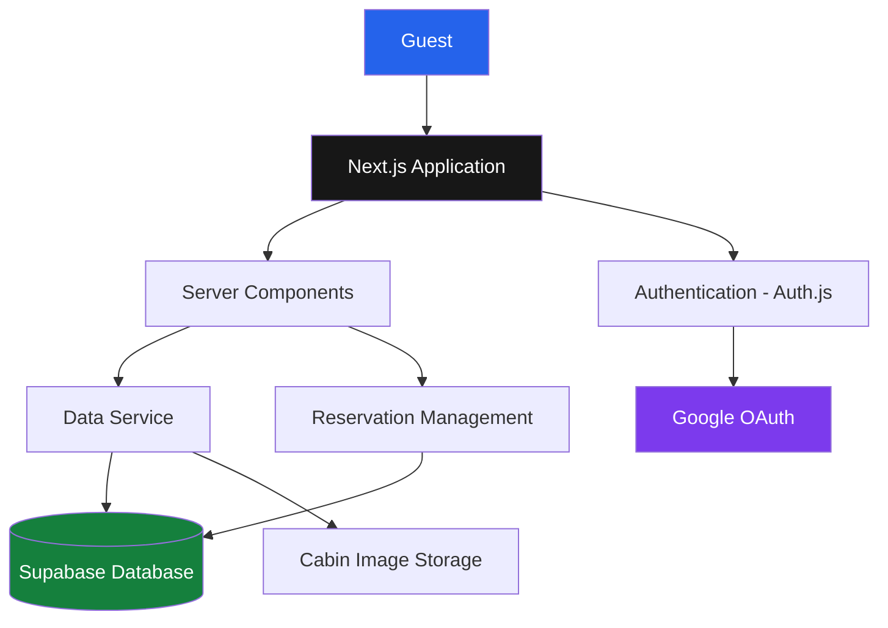
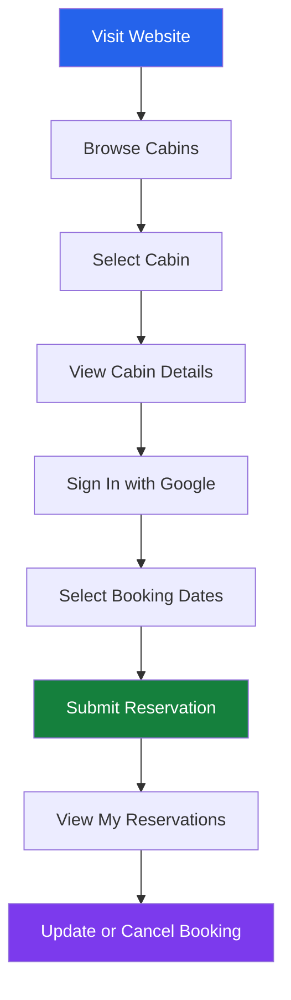

# 🏕️ The Wild Oasis — Cabin Booking

<p align="center">
  A modern cabin booking platform built with Next.js.
  <br />
  Explore luxury cabins, check availability, and manage reservations.
  <br /><br />
  <a href="https://wild-oasis-cabin-booking.vercel.app/">🌐 Live Demo</a>
</p>

<p align="center">
  
  
  
  
  
  
</p>

---

## ✨ Overview

**The Wild Oasis** is a full-stack cabin booking application where guests can explore available cabins, view cabin details, select booking dates, and manage their reservations.

The application focuses on a smooth booking experience, secure authentication, responsive design, and modern Next.js features.

## 🚀 Features

| Feature | Description |
|:---|:---|
| 🏡 Cabin Browsing | Explore available luxury cabins |
| 🔍 Cabin Filtering | Filter cabins based on preferences |
| 📅 Date Selection | Interactive check-in and check-out selection |
| 🔐 Authentication | Google OAuth using Auth.js |
| 📋 Reservations | Create and view personal bookings |
| ✏️ Update Booking | Modify existing reservations |
| ❌ Cancellation | Cancel existing reservations |
| 📱 Responsive UI | Desktop, tablet and mobile support |
| ⚡ Server Rendering | Next.js server components and data fetching |

## 🛠️ Tech Stack

<p align="center">

| Technology | Usage |
|:---:|:---|
| Next.js | Full-stack React framework |
| React | Component-based UI |
| Tailwind CSS | Styling |
| Supabase | Database and image storage |
| Auth.js | Authentication |
| React Day Picker | Date selection |
| date-fns | Date manipulation |
| Vercel | Deployment |

</p>

## 🏗️ Application Architecture



## 🔄 Booking Workflow



## 📂 Project Structure

```text
wild-oasis-cabin-booking/
│
├── app/
│   ├── _components/
│   ├── account/
│   ├── cabins/
│   ├── about/
│   ├── api/
│   ├── layout.js
│   └── page.js
│
├── components/
│
├── lib/
│   ├── actions.js
│   ├── auth.js
│   └── data-service.js
│
├── public/
│
├── .env.local
├── next.config.js
├── package.json
└── README.md
```

*Adjust the structure above to match the actual repository.*

## ⚙️ Getting Started

### 1. Clone the repository

```bash
git clone YOUR_GITHUB_REPOSITORY_URL
```

### 2. Navigate to the project

```bash
cd wild-oasis-cabin-booking
```

### 3. Install dependencies

```bash
npm install
```

### 4. Configure environment variables

Create a `.env.local` file:

```env
AUTH_SECRET=your_auth_secret
AUTH_GOOGLE_ID=your_google_client_id
AUTH_GOOGLE_SECRET=your_google_client_secret

NEXT_PUBLIC_SUPABASE_URL=your_supabase_url
NEXT_PUBLIC_SUPABASE_KEY=your_supabase_key
```

Use the exact variable names required by your application. Never commit actual credentials.

### 5. Start development server

```bash
npm run dev
```

Open http://localhost:3000.

### 6. Production build

```bash
npm run build
npm start
```

## 🌐 Live Deployment

<p align="center">
  <strong>THE WILD OASIS</strong>
  <br />
  <a href="https://wild-oasis-cabin-booking.vercel.app/">Visit Live Application ↗</a>
  <br /><br />
  Deployed with Vercel
</p>

## 🎯 What I Learned

- Building full-stack applications using Next.js.
- Server-side data fetching and rendering.
- Authentication and session management with Auth.js.
- Database integration using Supabase.
- Managing reservations and booking dates.
- Caching, revalidation and Suspense.
- Responsive UI development using Tailwind CSS.
- Production deployment using Vercel.

## 👨‍💻 Developer

**Nagesh L.**

- GitHub: [Your GitHub Profile](YOUR_GITHUB_PROFILE_URL)
- LinkedIn: [Your LinkedIn Profile](YOUR_LINKEDIN_PROFILE_URL)

---

<p align="center">
  <strong>Built with ❤️ using Next.js</strong>
  <br />
  ⭐ If you like this project, consider giving it a star!
</p>
